  

  
  
  
  

<b>¿Necesitás un desarrollador?</b> Hago scraping y automatizaciones con Python e IA, landing pages y arreglo errores en proyectos Python, JavaScript y React. 
<a href="https://www.fiverr.com/bruno_savarella">Contratame en Fiverr</a> con pago protegido, o escribime directo.

---

### `$ cat sobre_mi.md`

Estudio **Ingeniería en Sistemas de Información** en la **UTN** (2023 – en curso) y programo desde Córdoba, Argentina.
Me gusta construir software que resuelve problemas concretos, y casi siempre termina mezclando varias cosas:

- 👁️ **Visión por computadora y biometría.** Reconocimiento facial con prueba de vida y biometría cifrada.
- 🧠 **IA aplicada.** Un tutor de matemática que resuelve ejercicios a partir de una foto.
- 📡 **Seguridad y privacidad.** Análisis pasivo de entornos Bluetooth Low Energy.
- 🎧 **Audio.** Herramientas para DJs y productores. Mi portfolio tiene un tema de house sintetizado en vivo con Web Audio.
- 🛒 **Web.** Tiendas y sitios con Next.js, desde el diseño hasta el deploy.

### `$ ls stack/`

  

### `$ ls proyectos/ --destacados`

<table>
  <tr>
    <td width="50%" valign="top">
      <h4><a href="https://github.com/Brun02005/WaveLoad">🎚️ WaveLoad</a></h4>
      
Software de escritorio para gestionar y analizar catálogos de audio: análisis de señal, grafo de compatibilidad entre temas y arquitectura hexagonal. <b>646 tests.</b>

      
      
      
    </td>
    <td width="50%" valign="top">
      <h4><a href="https://github.com/Brun02005/control-acceso-facial">🔐 Control de acceso facial</a></h4>
      
Control de acceso y fichaje por reconocimiento facial, con prueba de vida y biometría cifrada. <b>FAR ~0,008 % en LFW.</b>

      
      
      
    </td>
  </tr>
  <tr>
    <td width="50%" valign="top">
      <h4><a href="https://github.com/Brun02005/mathvision-ai">🧮 MathVision AI</a></h4>
      
Tutor de matemática con IA: resuelve ejercicios universitarios paso a paso desde una foto, con OCR de Gemini Vision y cálculo simbólico. <i>En desarrollo.</i>

      
      
      
    </td>
    <td width="50%" valign="top">
      <h4><a href="https://github.com/Brun02005/BLUE-DAR">📡 BLUE-DAR</a></h4>
      
Análisis pasivo de entornos Bluetooth Low Energy para auditorías de seguridad: clasificación explicable de dispositivos y detección de BLE spam, con privacidad por diseño.

      
      
    </td>
  </tr>
  <tr>
    <td width="50%" valign="top">
      <h4><a href="https://github.com/Brun02005/foxtrot-sur-store">🛒 Foxtrot Sur Store</a></h4>
      
Tienda online de indumentaria táctica hecha en Argentina.

      
      
      
    </td>
    <td width="50%" valign="top">
      <h4><a href="https://brun02005.github.io">λ brun02005.github.io</a></h4>
      
Mi portfolio: una terminal interactiva en blanco y negro con música house sintetizada en vivo. Probá <code>play</code>, <code>drop</code> y <code>bpm 128</code>. Un solo <code>index.html</code>, sin frameworks.

      
      
    </td>
  </tr>
</table>

### `$ git log --graph`

  <picture>
    <source media="(prefers-color-scheme: dark)" srcset="https://raw.githubusercontent.com/Brun02005/Brun02005/output/github-snake-dark.svg">
    <source media="(prefers-color-scheme: light)" srcset="https://raw.githubusercontent.com/Brun02005/Brun02005/output/github-snake.svg">
    
  </picture>

  

<code>bruno@cordoba:~$ exit</code>

